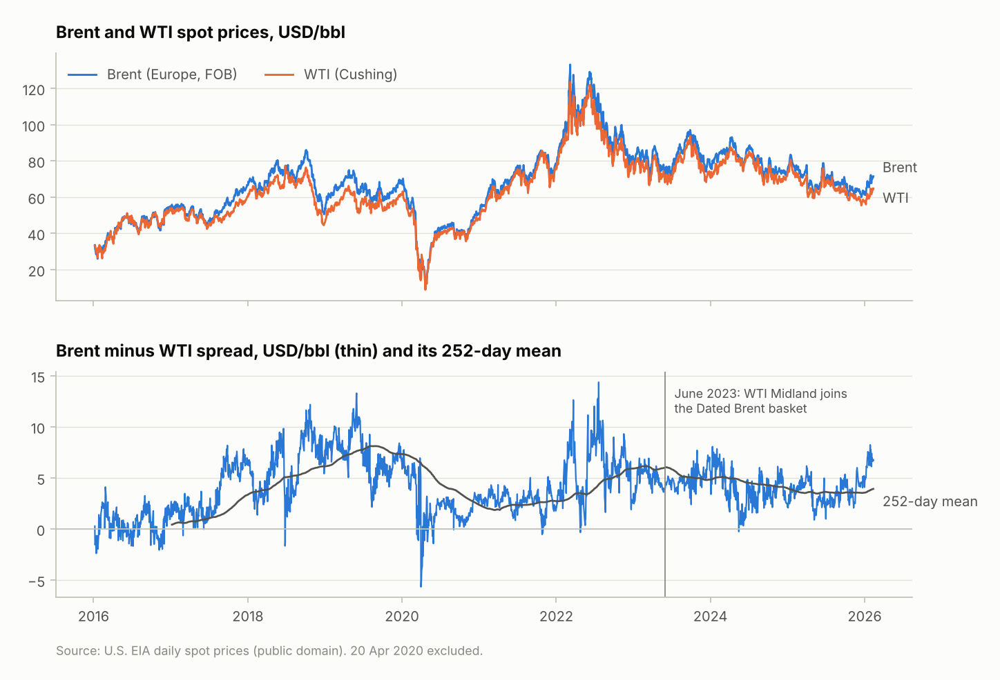

[](LICENSE)

# Energy Trading Analytics

**Python toolkit for energy market analysis, starting with Brent-WTI spread trading**

Built on public EIA data, no Bloomberg Terminal required.

---

## Overview

This repository groups my **projects on crude oil and refined products markets**. Each project is a standalone Python script that reads the EIA data and produces its charts and result tables.

The core idea is to:

 **Turn energy market analyses into reproducible Python tools: tested, documented and runnable by anyone on public data.**

| Project | Description | Main Tools |
|---|---|---|
| [Brent-WTI Spread Trading](projects/01_brent_wti_spread) | Mean-reversion analysis of the Brent-WTI spread, z-score strategy backtest, options on the spread | ADF, Engle-Granger, Ornstein-Uhlenbeck, Bachelier, Kirk |

More projects to come (price risk models, storage economics).



---

## Key Results

| Project | Result |
|---|---|
| Brent-WTI Spread | Half-life down from **17 to 4 trading days** since WTI Midland joined Dated Brent (June 2023) |
| Brent-WTI Spread | Z-score strategy: **Sharpe 0.66** at next-close execution vs 1.01 at same-close execution |

---

## Project Structure

```
energy-trading-analytics/
├── data/                              # EIA daily spot prices (Brent, WTI)
├── projects/
│   └── 01_brent_wti_spread/
│       ├── brent_wti_spread.py        # Stats, OU calibration, z-score backtest, spread options
│       ├── figures/
│       └── results.md
├── scripts/update_data.py             # Refresh the EIA data
└── requirements.txt
```

---

## Installation

```bash
# Clone the repository
git clone https://github.com/Paul-Roseau/energy-trading-analytics.git
cd energy-trading-analytics

# Install dependencies
pip install -r requirements.txt
```

## Running the Projects

```bash
python projects/01_brent_wti_spread/brent_wti_spread.py
```

Each script writes its charts to `figures/` and its tables to `results.md`.

---

## Data

* **Source**: U.S. Energy Information Administration (EIA), daily spot prices
* **Series**: Europe Brent (FOB) and WTI (Cushing)
* **Access**: [datahub.io oil-prices package](https://github.com/datasets/oil-prices)
* **Licence**: public domain
* Refresh with `python scripts/update_data.py`

---

## Technology Stack

* **Python**
* **pandas / NumPy**: data handling
* **SciPy / statsmodels**: statistics and econometrics
* **Matplotlib**: charts

---

## Background

* Analyses originally developed during my MSc in Energy Management at ESCP Business School (London, 2025-2026)
* This repository is a rewrite, published in November 2026, on public EIA data
* Original coursework co-written with Satyam Patil, Llyse Igondjo Vandji and Roman Tschare
* The original work used Bloomberg data, which is not redistributed here

---

## Disclaimer

This repository is for **research and educational purposes only**.
It is **not investment advice** and is not intended for live trading.

---

## Author

**Paul Roseau** | MSc Energy Management, ESCP Business School

[](https://www.linkedin.com/in/paul-roseau-ba6a96174)
[](https://github.com/Paul-Roseau)
