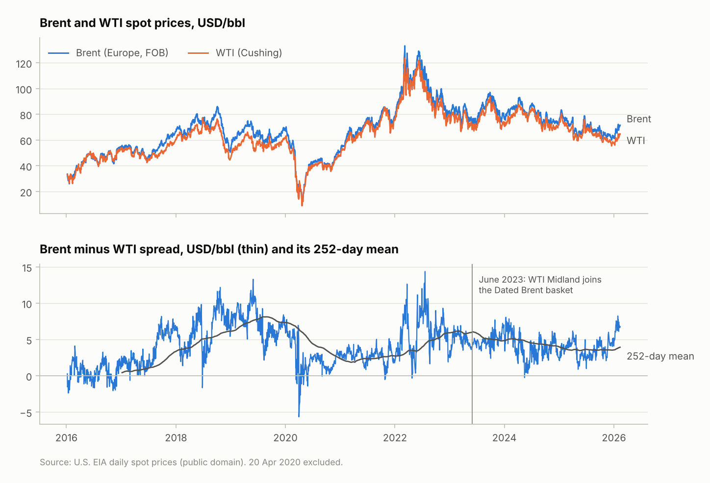
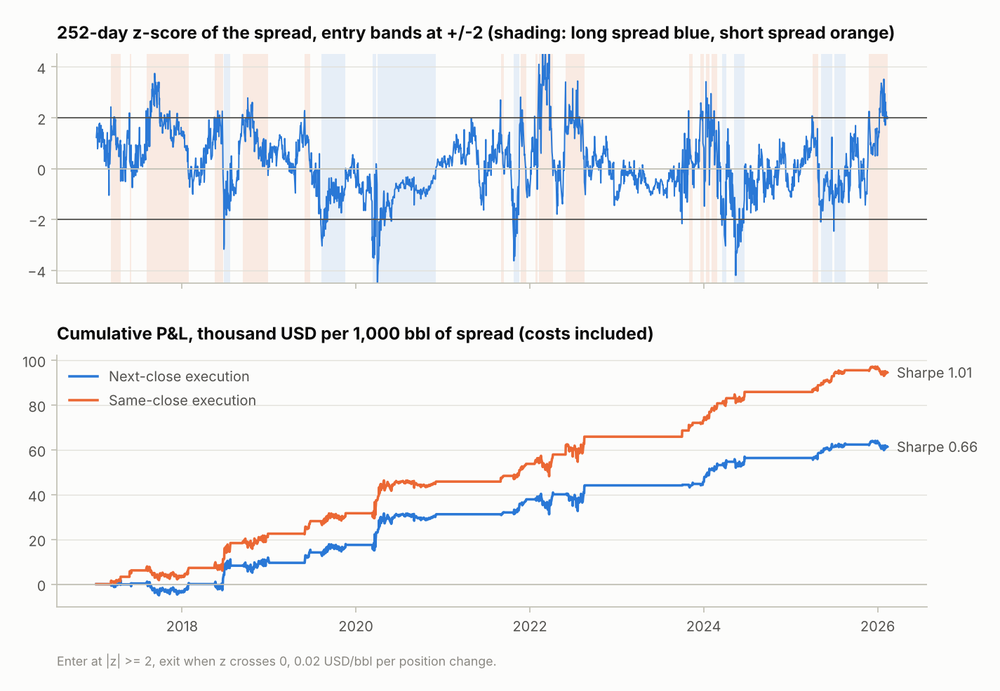
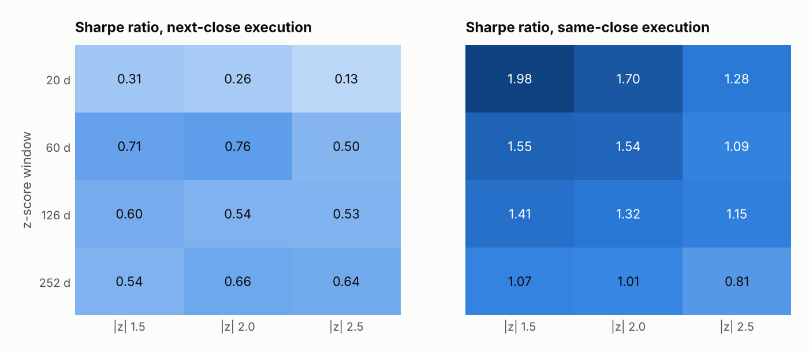
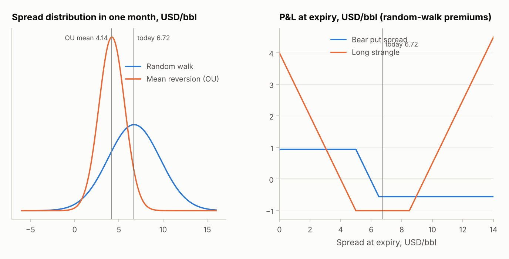

# Brent-WTI Spread Trading

**Mean-reversion analysis, z-score trading strategy and option pricing on the Brent-WTI spread**

## Overview

This project studies the **Brent-WTI spread** over **2016-2026** using EIA daily spot prices.

The core idea is to:

> **Test whether the spread is mean-reverting enough to trade, measure how a simple z-score strategy performs under realistic execution, and price options on the spread with models suited to spreads.**

The project provides:

* Stationarity and cointegration tests on the two benchmarks
* Ornstein-Uhlenbeck calibration, full sample and by market regime
* A z-score strategy backtest with execution lag and transaction costs
* Spread option pricing (Bachelier, Kirk) and payoff analysis



---

## Data

* **Source**: U.S. EIA daily spot prices, Europe Brent (FOB) and WTI (Cushing)
* **Period**: 7 January 2016 to 11 February 2026
* **Observations**: 2,493 dates common to both series
* Series joined on dates (the two benchmarks do not share the same holiday calendar)
* 20 April 2020 excluded: WTI spot printed -36.98 USD/bbl the day before the May 2020 NYMEX expiry

> Spot assessments are used as a proxy for the tradable ICE Brent / NYMEX WTI futures spread.

---

## Methodology

### 1. Stationarity & Cointegration

* ADF test on log Brent, log WTI and the spread
* Engle-Granger cointegration test (log Brent on log WTI)

### 2. Ornstein-Uhlenbeck Model

* `dS = κ(θ − S)dt + σdW`
* Calibrated through the exact AR(1) discretisation: `κ = −ln(b)`, `θ = a / (1 − b)`
* Half-life: `ln(2) / κ`
* Estimated on the full sample and on three regimes

### 3. Z-Score Strategy

* 252-day rolling z-score
* Short the spread at z ≥ 2, long at z ≤ −2, exit when z crosses 0
* Orders executed at the **next close** (no look-ahead)
* Transaction cost: 0.02 USD/bbl per position change
* Size: 1,000 bbl of spread (one lot per leg)

### 4. Options on the Spread

* **Bachelier (normal model)**: the spread can be negative and its volatility is stable in USD/bbl
* **Kirk approximation**: same option priced from the two legs' volatilities and correlation
* **OU-consistent volatility**: one-month dispersion implied by mean reversion

---

## Key Results

### Stationarity

| Series | ADF statistic | p-value |
|---|---|---|
| log Brent | -3.33 | 0.014 |
| log WTI | -3.30 | 0.015 |
| Brent - WTI spread | -4.02 | 0.001 |

Engle-Granger: -3.90 (p = 0.010). The spread is stationary and the two legs are cointegrated.

### Ornstein-Uhlenbeck Parameters

| Period | Obs | Mean | Std | Half-life (days) | θ |
|---|---|---|---|---|---|
| Full sample | 2,493 | 4.10 | 2.72 | 10.9 | 4.14 |
| 2016 - 2019 | 993 | 4.31 | 3.39 | 17.4 | 4.47 |
| 2020 - May 2023 | 839 | 3.82 | 2.55 | 7.8 | 3.79 |
| June 2023 - Feb 2026 | 661 | 4.12 | 1.45 | 4.1 | 4.14 |

> Since June 2023, when Platts started reflecting WTI Midland cargoes in Dated Brent, the spread reverts about 4 times faster than in 2016-2019 and its standard deviation fell from 3.39 to 1.45 USD/bbl.

### Backtest Performance

| Metric | Next-close execution | Same-close execution |
|---|---|---|
| Sharpe ratio | 0.66 | 1.01 |
| P&L per year (USD) | 6,895 | 10,622 |
| Max drawdown (USD) | -9,130 | -9,130 |
| Trades (Jan 2017 - Feb 2026) | 27 | 27 |
| Hit rate | 88% | 100% |
| Average holding period | 34 days | 34 days |





* Execution timing drives a large part of the result: with a 20-day window, the Sharpe ratio is 1.70 at same-close execution but 0.26 at next close
* Across the parameter grid, next-close Sharpe ratios range from 0.13 to 0.76

### Options on the Spread (21 trading days)

Inputs on 11 February 2026: spread 6.72 USD/bbl, normal volatility 10.21 USD/bbl/√yr (60-day realised), Brent vol 31.1%, WTI vol 27.6%, correlation 0.875, rate 4% (assumed).

| Option | Bachelier | Kirk | OU-consistent vol |
|---|---|---|---|
| Put 6.50 | 1.066 | 1.139 | 0.478 |
| Put 5.00 | 0.509 | 0.556 | 0.086 |
| Call 8.50 | 0.492 | 0.577 | 0.079 |

| Strategy | Cost | Value with OU vol | Break-even(s) | Max profit | Max loss |
|---|---|---|---|---|---|
| Bear put spread 6.50 / 5.00 | 0.557 | 0.392 | 5.94 | 0.94 | -0.56 |
| Long strangle 5.00 / 8.50 | 1.001 | 0.164 | 4.00 / 9.50 | Unlimited | -1.00 |



> With a 4-day half-life, the one-month dispersion of the spread is about half of what daily volatility implies (5.06 vs 10.21 USD/bbl/√yr): a strangle bought at random-walk volatility (1.00) is worth 0.16 under mean reversion.

* The OU model expects the spread to drift from 6.72 back to about 4.21 within a month
* A 6.50 / 5.00 bear put spread expresses that view for 0.56 USD/bbl, with a maximum payoff of 1.50
* To be checked against the futures curve, which may already price part of the convergence

---

## Limitations & Considerations

* Spot assessments, not the futures actually traded; no roll or margin financing in the backtest
* 27 trades over nine years: a Sharpe ratio of 0.66 has a standard error of about 0.37 (Lo, 2002) and is not significant at 5%
* OU parameters estimated on the same data the strategy trades (only the z-score is rolling)
* Single-factor model: regime breaks such as 2020 and 2022 dominate the risk

---

## Running the Project

```bash
python projects/01_brent_wti_spread/brent_wti_spread.py
```

Outputs:

* `figures/`: charts
* [`results.md`](results.md): all tables at full precision

Tests (OU calibration on simulated data, entry and exit rules of the z-score strategy, backtest accounting, transaction costs and execution lag, alignment of the two price series):

```bash
pip install -r requirements-dev.txt
python -m pytest projects/01_brent_wti_spread
```
