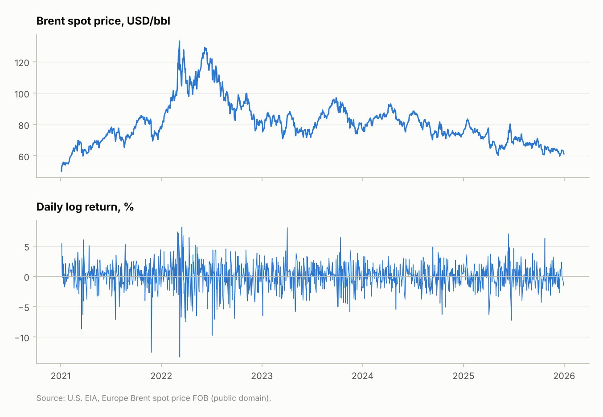

# Oil Price Risk Models

**Brent crude price behaviour, as a base for price models and Value-at-Risk**

## Overview

This project studies **Brent crude** using EIA daily spot prices from **2021 to 2025**.

The core idea is to:

> **Describe how Brent behaves before choosing a price model or a risk measure.**

The project provides:

* Descriptive statistics on prices and log returns
* Unit-root tests (ADF) on log prices and returns
* Price models and VaR: in progress



---

## Data

* **Source**: U.S. EIA, Europe Brent spot price (FOB)
* **Period**: 4 January 2021 to 31 December 2025 (1,263 daily prices)

---

## Key Results

### Stylised Facts

| | Price (USD/bbl) | Daily log return |
|---|---|---|
| Mean | 80.77 | 3.9% annualised |
| Standard deviation | 14.02 | 35.1% annualised |
| Skewness | 1.06 | -0.53 |
| Excess kurtosis | 1.37 | 2.93 |
| ADF statistic (p-value) | -2.30 (0.17), log price | -17.34 (0.00) |

* Returns are fat-tailed and skewed to the downside: a normal distribution understates large daily losses
* The ADF test cannot reject a unit root on log prices, but clearly rejects it on returns

---

## Running the Project

```bash
python projects/02_oil_price_risk/oil_price_risk.py
```

Outputs:

* `figures/`: charts
* [`results.md`](results.md): all tables at full precision
