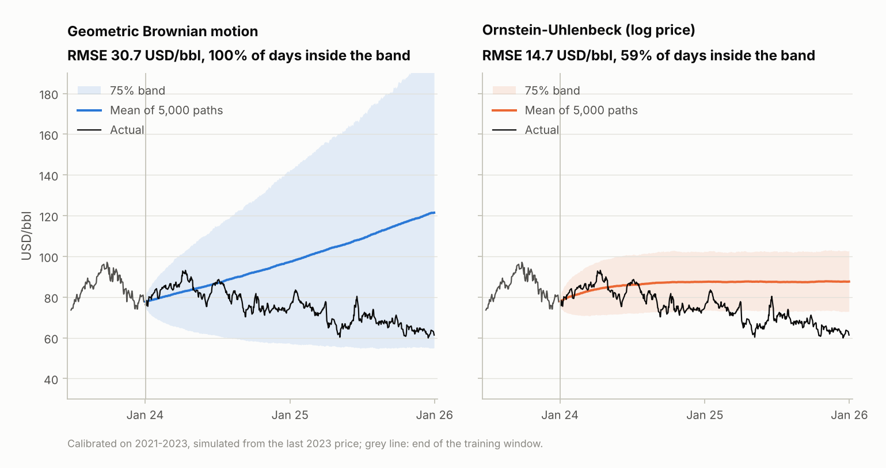

# Oil Price Risk Models

**Monte Carlo price forecasts on Brent crude, with one-day Value-at-Risk backtesting to follow**

## Overview

This project compares **stochastic price models** on Brent crude, using EIA daily spot prices from **2021 to 2025**.

The core idea is to:

> **Calibrate simple price models on 2021-2023 and test their forecasts on 2024-2025.**

The project provides:

* Descriptive statistics and unit-root tests on prices and returns
* GBM and Ornstein-Uhlenbeck calibration, Monte Carlo simulation (5,000 paths)
* Out-of-sample forecast evaluation (RMSE, band coverage)
* VaR models and backtests: in progress


---

## Data

* **Source**: U.S. EIA, Europe Brent spot price (FOB)
* **Period**: 4 January 2021 to 31 December 2025 (1,263 daily prices)
* **Training window**: 2021-2023
* **Test window**: 2024-2025

---

## Models

### 1. Geometric Brownian Motion (GBM)

* `dS = μS dt + σS dW`
* Maximum-likelihood estimation from log returns

### 2. Ornstein-Uhlenbeck on Log Prices

* `dX = κ(θ − X)dt + σdW`, with `X = ln(S)`
* Exact AR(1) calibration
* Kendall small-sample bias correction on κ

---

## Key Results

### Stylised Facts

| | Price (USD/bbl) | Daily log return |
|---|---|---|
| Mean | 80.77 | 3.9% annualised |
| Standard deviation | 14.02 | 35.1% annualised |
| Skewness | 1.06 | -0.53 |
| Excess kurtosis | 1.37 | 2.93 |
| ADF statistic (p-value) | -2.30 (0.17), log price | -17.34 (0.00) |

### Calibrated Parameters (2021-2023)

| Parameter | GBM | OU on log price |
|---|---|---|
| Drift | 22.0% per year | - |
| Volatility | 38.9% | 39.0% |
| Mean-reversion speed κ | - | 3.58 per year |
| Half-life | - | 49 trading days |
| Long-run level | - | 86.82 USD/bbl |
| κ after Kendall correction | - | 2.24 (half-life 78 days) |

> The 22% GBM drift mostly reflects the 2021 recovery from 50 USD/bbl. The OU speed is weakly identified: the ADF test cannot reject a unit root on the same window, and the bias correction alone moves the half-life from 49 to 78 days.

### Monte Carlo Forecasts (5,000 paths from 77.69 USD/bbl)

| Horizon | Model | Mean at horizon | 75% band at horizon | Actual | RMSE | Days inside band |
|---|---|---|---|---|---|---|
| 2024 | GBM | 97.26 | 57.12 - 142.20 | 74.58 | 12.06 | 100% |
| 2024 | OU | 87.48 | 73.47 - 102.52 | 74.58 | 8.28 | 94% |
| 2024-2025 | GBM | 121.44 | 54.99 - 197.23 | 61.35 | 30.70 | 100% |
| 2024-2025 | OU | 87.62 | 72.86 - 102.85 | 61.35 | 14.74 | 59% |



* OU gives the better point forecast on both horizons
* Over two years its band is too narrow (59% of days inside vs 75% expected): prices settled below its long-run level in 2025
* The GBM band contains every day only because it is very wide

---

## Limitations & Considerations

* Spot prices only
* Single-factor models cannot move their long-run level (a two-factor Schwartz-Smith model would)

---

## Running the Project

```bash
python projects/02_oil_price_risk/oil_price_risk.py
```

Outputs:

* `figures/`: charts
* [`results.md`](results.md): all tables at full precision
