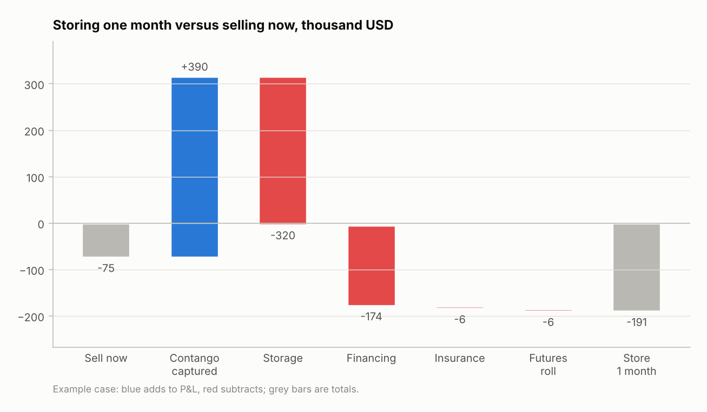
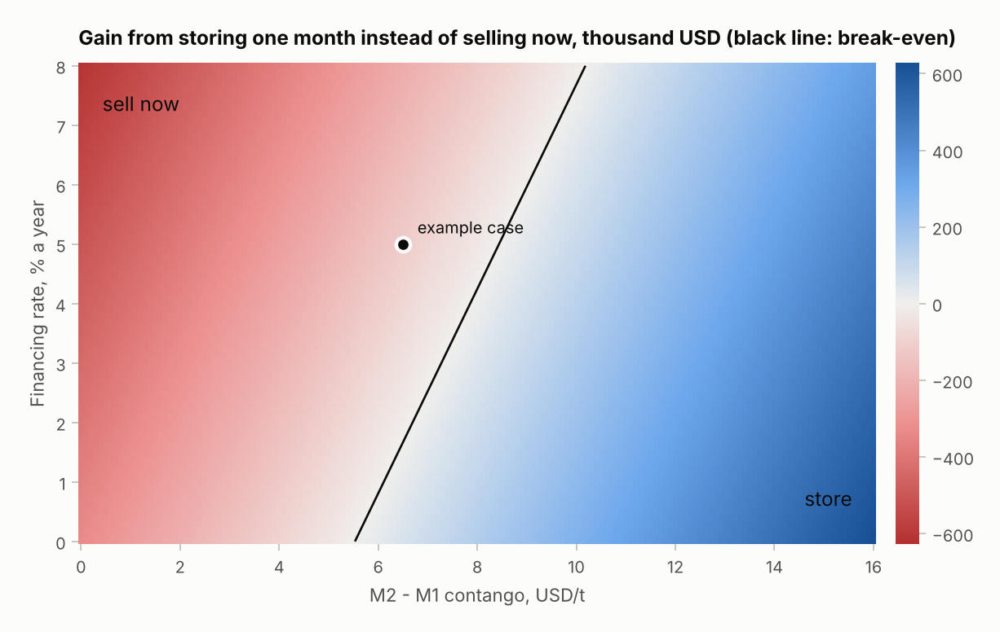

# Storage Arbitrage Calculator

**Sell now or store? Cash-and-carry economics of a hedged diesel cargo in a contango market**

## Overview

A trader owns a **diesel cargo hedged with a short ICE Gasoil position** on the prompt month (M1). The forward curve is in **contango**.

The core idea is to:

> **Price each option (sell now, store one month, store two months), break down the P&L and compute the break-evens that drive the decision.**

The calculator gives:

* Net P&L per option, broken down by component (physical, hedge, storage, financing, insurance, futures roll)
* Break-even contango and break-even financing rate
* Break-even spread for a storage extension option
* Sensitivity scenarios and a decision map

---

## Input: JSON Case File

All inputs are stored in a **JSON file** ([`example_case.json`](example_case.json)) containing:

* **Cargo**: mass (t), density (kg/l), purchase price, hedge level
* **Tank**: capacity (m3), storage rate, extension option premium
* **Market**: futures curve (M1, M2, M3...), sale differential, financing rate, insurance, roll cost

---

## P&L Logic

For a storage horizon of n months:

1. The original M1 short is bought back at today's M1 → hedge P&L
2. A new short in M(1+n) locks the physical sale at `curve[n] + differential`
3. Storage, financing (ACT/360) and insurance accrue for n months
4. `Net P&L = physical + hedge − storage − financing − insurance − roll`

---

## Example Case

| Input | Value |
|---|---|
| Cargo | 60,000 t of diesel 10 ppm, density 0.845 kg/l = 71,006 m3 |
| Purchase price / hedge | 698.00 USD/t, hedged by selling M1 at 698.00 |
| Futures curve | M1 700.00, M2 706.50, M3 711.00 USD/t |
| Physical sale | Matching futures month minus 1.25 USD/t |
| Tank | 75,000 m3 at 4.50 USD/m3 per month, extension option at 1.00 USD/m3 |
| Financing / insurance | 5% per year (ACT/360) / 0.015% of cargo value per month |
| Futures roll | 0.10 USD/t |

---

## Key Results

### P&L by Option

| USD | Sell now | Store 1 month | Store 2 months |
|---|---|---|---|
| Sale price (USD/t) | 698.75 | 705.25 | 709.75 |
| Physical P&L | 45,000 | 435,000 | 705,000 |
| Hedge P&L (buy back M1) | -120,000 | -120,000 | -120,000 |
| Storage | 0 | -319,527 | -639,053 |
| Financing | 0 | -174,500 | -349,000 |
| Insurance and roll | 0 | -12,282 | -18,564 |
| **Net P&L** | **-75,000** | **-191,309** | **-421,617** |
| Per tonne | -1.25 | -3.19 | -7.03 |



### Break-Evens

| Break-even | Needed | Available |
|---|---|---|
| M2 - M1 contango to store one month | 8.44 USD/t | 6.50 USD/t |
| M3 - M1 contango to store two months | 16.78 USD/t | 11.00 USD/t |
| Financing rate for one month of storage | 1.67% | 5.00% |
| M2 - M3 spread to justify the extension option | 9.52 USD/t | 4.50 USD/t |



### Sensitivity

| Scenario | Sell now | Store 1 month | Store 2 months | Best |
|---|---|---|---|---|
| Base case | -75,000 | -191,309 | -421,617 | Sell now |
| No financing cost | -75,000 | -16,809 | -72,617 | Store 1 month |
| Whole tank charged | -75,000 | -209,282 | -457,564 | Sell now |

> Contango is necessary, not sufficient: 6.50 USD/t covers storage (5.33 USD/t) but not storage plus financing (8.44 USD/t). Financing is the swing factor: the decision flips at 1.67%.

* The hedge P&L (-120,000 USD) is identical in every option: it is sunk and should not drive the decision
* Paying for the whole 75,000 m3 tank instead of the 71,006 m3 used adds about 18,000 USD per month

---

## Running the Calculator

```bash
# Example case
python projects/03_storage_arbitrage/storage_calculator.py

# Your own case
python projects/03_storage_arbitrage/storage_calculator.py --config my_case.json
```

Set `charge_full_capacity` to `true` when the whole tank is rented.

---

## Assumptions & Limitations

* Physical sale priced against the futures month matching the delivery
* Rolling the hedge locks the price: curve moves between today and the sale do not change the P&L
* Financing on the purchase value (ACT/360)
* Product losses, quality and freight ignored
